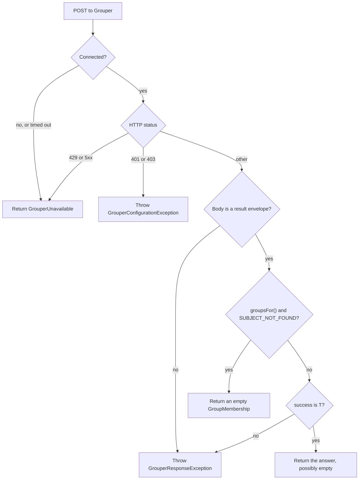

# Outcomes

> For PHP developers deciding how their code handles each answer a Grouper lookup can give.

Every lookup ends in one of three ways: an answer, `GrouperUnavailable`, or an exception. A condition
that can clear on its own is returned as `GrouperUnavailable`. A condition a person must fix is thrown.

Diagram as text

1. If the connection fails or times out, the lookup returns `GrouperUnavailable`.
2. If Grouper answers 429 or any 5xx status, the lookup returns `GrouperUnavailable` with the status.
3. If Grouper answers 401 or 403, the lookup throws `GrouperConfigurationException`.
4. If the body isn't the result envelope the lookup expects, it throws `GrouperResponseException`.
5. If `groupsFor()` gets the result code `SUBJECT_NOT_FOUND`, it returns an empty `GroupMembership`.
6. If the result's `success` isn't `T`, the lookup throws `GrouperResponseException`.
7. Otherwise the lookup returns its answer, which can be empty.

## Answers

| Lookup | Answer |
|---|---|
| `groupsFor()` | A `GroupMembership`, empty when the user has no groups under the stem |
| `groupExists()` | `true` or `false` |
| `findByLabel()` | A list of `GrouperGroup`, empty when no group under the stem has that label |

An empty answer is a real answer: Grouper was reached, and nothing matched. Don't treat it like
`GrouperUnavailable`, which means the answer is unknown.

Grouper reports a failure in the body's `success` field, not only in the HTTP status. A `200` can carry
a failure, and a `404` can carry `SUBJECT_NOT_FOUND`.

## Grouper unavailable

`GrouperUnavailable` is a value, not an exception, so static analysis flags code that reads the groups
without handling it first. What your app does next is its own policy: deny, serve a cached answer or
show an error. guild/grouper doesn't cache. In a Guild app, the framework's authorization makes that
decision.

`GrouperUnavailable` carries a `reason`, the HTTP `statusCode` when there was one, and the underlying
exception as `previous`.

## Rejected credentials

Grouper's 401 or 403 means the service account is wrong, and it won't fix itself. guild/grouper throws
`GrouperConfigurationException` instead of returning `GrouperUnavailable`, so a deployment with bad
credentials fails visibly instead of denying everyone.

## Unknown users

When a username isn't in Grouper at all, such as a deprovisioned account, a guest or a typo, Grouper
answers `404` with `SUBJECT_NOT_FOUND`. `groupsFor()` returns an empty membership. An access check then
denies the user, instead of the app answering with a 500 error.

An unknown username therefore looks the same as a real user with no groups. To tell them apart, such as
on an admin page that assigns access by username, check the username against your identity source first.

Any other failure code still throws. A stem that doesn't exist answers `400 INVALID_QUERY`, which is a
configuration error, not a user without groups.

## Related

- [Configure the client](../guides/configure-the-client.md) explains how the stem limits each answer.
- [Why guild/grouper only reads](../decisions/0001-read-only-lookup.md) explains what it leaves to your app.
